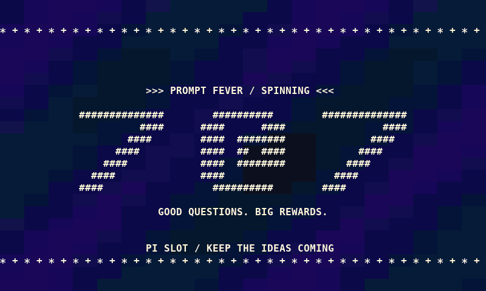

# pi-slot

Slot machine animations for [pi](https://pi.dev), with live responses, rainbow jackpots, and confetti. Built for pi 1.3.0.



## Install

```sh
pi install git:github.com/butsugiri/pi-slot
```

Start `pi` as usual, or run `/reload` in an existing session. Try `/slot-demo` for an instant jackpot.

## Commands

| Command | Action |
| --- | --- |
| `/slot` | Show settings |
| `/slot on` / `/slot off` | Toggle animations |
| `/slot mode random` | Draw each outcome with a 25% chance |
| `/slot mode score` | Use keyword-based prompt scoring (default) |
| `/slot intensity low\|normal\|high` | Set effects (default: high) |
| `/slot stop` | Stop the animation |
| `/slot-demo --help` | Explore demo outcomes and patterns |

Animations run alongside response generation in interactive mode. Settings reset on reload or restart.

## Develop

```sh
pi -e .
npm test
```
